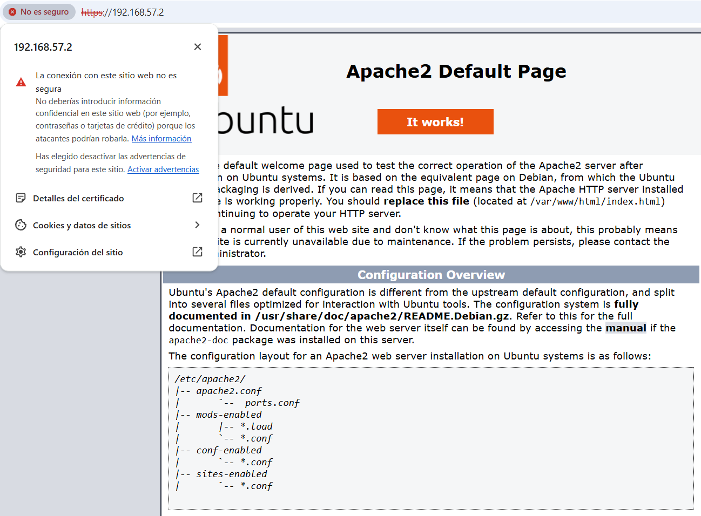
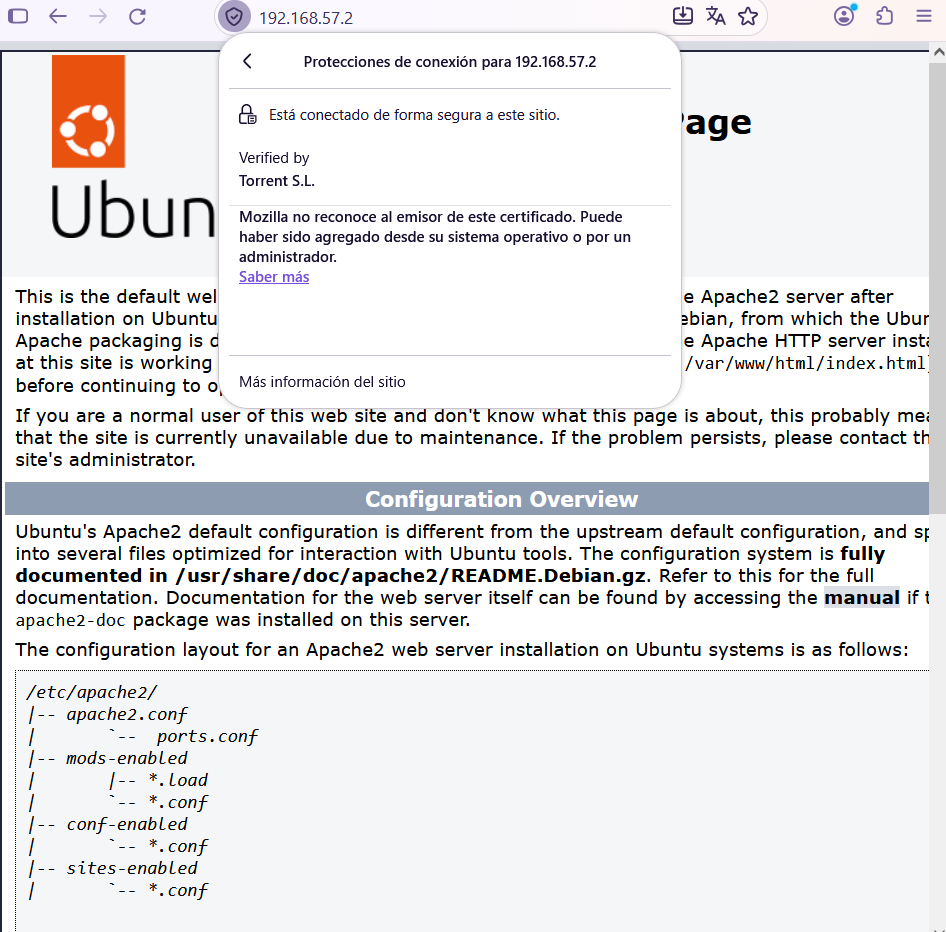
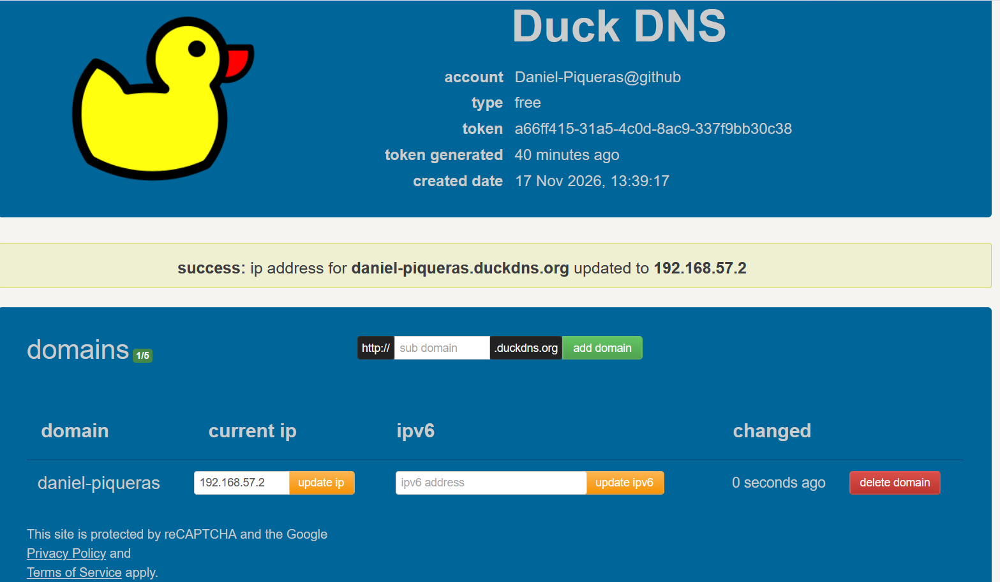
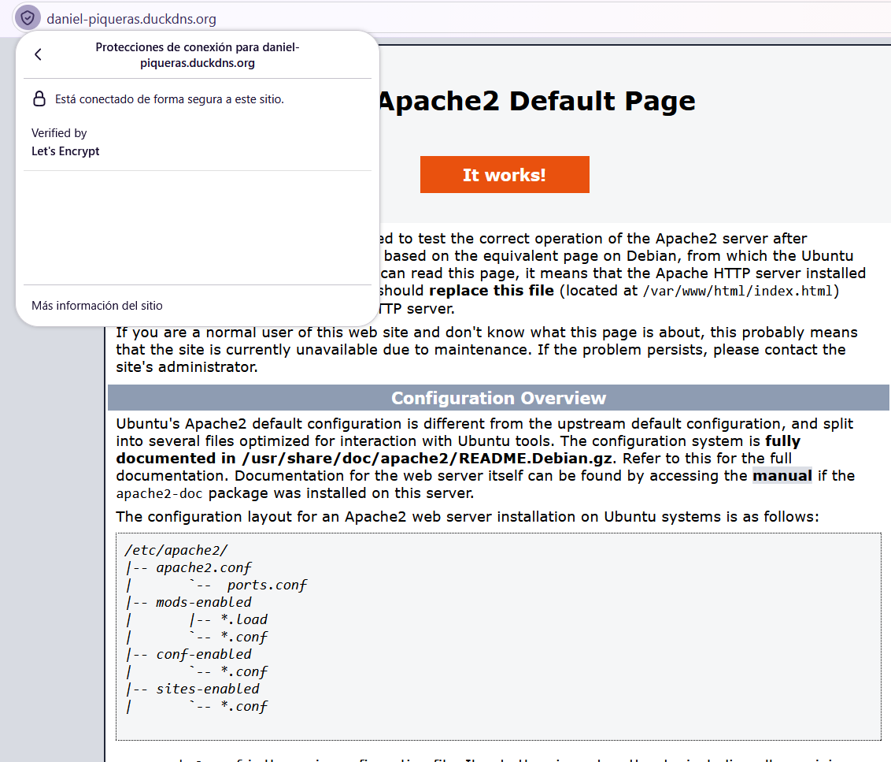

# UD03 · Certificados y HTTPS

**Alumno:** Daniel Piqueras Burriel

---

# 0.1 Configuración de red

* **Configuración de VirtualBox elegida:** **Configuración B (Dos adaptadores)**: Adaptador 1 en **NAT** (para salida a Internet y comunicación con DuckDNS y Let's Encrypt) y Adaptador 2 en **«Solo anfitrión»** (para acceder desde el navegador del equipo anfitrión).
* **`IP_SERVIDOR`:** `192.168.57.2`

---

# Parte 1 · Nuestra propia autoridad de certificación

## Paso 0 - Instalación de Apache

Instalación de paquetes necesarios:

```bash
sudo apt update
sudo apt install -y apache2 openssl curl cron
```

Comprobación:

```bash
systemctl status apache2 --no-pager
sudo ss -tlnp | grep ':80'
```

Resultado:

- Apache se encontraba en estado `active (running)`.
- El puerto 80 estaba abierto y escuchando conexiones.

Desde el navegador se accedió a:

```text
[http://192.168.57.2](http://192.168.57.2)
```

mostrándose correctamente la página `Apache2 Default Page`:



### ¿Qué indica el navegador?

El navegador indica que la conexión no es segura porque se está utilizando HTTP y no HTTPS. La información viaja sin cifrar y podría ser interceptada o modificada por un atacante situado en la red.

---

## Paso 1 - Creación de la estructura de la CA

Creación de directorios:

```bash
mkdir -p ~/ca/private ~/ca/certs
chmod 700 ~/ca/private
```

Comprobación:

```bash
ls -ld private
```

Resultado:

```text
drwx------
```

Esto garantiza que únicamente el usuario propietario puede acceder a las claves privadas.

---

## Paso 2 - Generación de la clave privada de la CA

Comando utilizado:

```bash
openssl genrsa -aes256 -out private/ca.key 4096
```

Resultado:

```text
ca.key
```

### Reflexión

La clave privada de una CA debe protegerse con una contraseña incluso aunque esté almacenada en un directorio con permisos restrictivos. Si un atacante consiguiera copiar el archivo, seguiría necesitando la contraseña para poder usarla.

---

## Paso 3 - Creación del certificado raíz

Comando utilizado:

```bash
openssl req -x509 -new -key private/ca.key -sha256 -days 3650 \
-out certs/ca.crt \
-subj "/C=ES/O=Torrent S.L./CN=Torrent S.L. CA Raiz" \
-addext "basicConstraints=critical,CA:TRUE" \
-addext "keyUsage=critical,keyCertSign,cRLSign"
```

Resultado:

Se generó el certificado:

```text
certs/ca.crt
```

---

## Paso 4 - Inspección del certificado raíz

Comandos utilizados:

```bash
openssl x509 -in certs/ca.crt -noout -subject -issuer -dates
openssl x509 -in certs/ca.crt -noout -text | grep -A1 "Basic Constraints"
```

Resultado:

```text
subject=C = ES, O = Torrent S.L., CN = Torrent S.L. CA Raiz
issuer=C = ES, O = Torrent S.L., CN = Torrent S.L. CA Raiz
CA:TRUE
```

### ¿Por qué coinciden Subject e Issuer?

Porque se trata de un certificado autofirmado. La propia Autoridad Certificadora firma su propio certificado.

### Fecha de validez

```text
notAfter=Nov 13 22:17:26 2036 GMT
```

La CA será válida hasta el 13 de noviembre de 2036.

---

## Paso 5 - Clave privada y CSR del servidor

Generación de la clave privada:

```bash
openssl genrsa -out private/srv.key 2048
```

Generación de la CSR:

```bash
openssl req -new -key private/srv.key -out srv.csr \
-subj "/C=ES/O=Torrent S.L./CN=hmi.torrent.local"
```

Archivos generados:

```text
srv.key
srv.csr
```

---

## Paso 6 - Configuración del SAN

Archivo creado:

```bash
nano srv.ext
```

Contenido:

```text
subjectAltName = DNS:hmi.torrent.local, IP:192.168.57.2
basicConstraints = CA:FALSE
keyUsage = digitalSignature, keyEncipherment
extendedKeyUsage = serverAuth
```

---

## Paso 7 - Firma del certificado del servidor

Comando utilizado:

```bash
openssl x509 -req -in srv.csr \
-CA certs/ca.crt -CAkey private/ca.key -CAcreateserial \
-out certs/srv.crt -days 365 -sha256 -extfile srv.ext
```

Resultado:

Se obtuvo:

```text
certs/srv.crt
```

### ¿Por qué el certificado del servidor dura 365 días?

Porque los certificados de servidor se renuevan con frecuencia para reducir el impacto de una posible filtración de la clave privada, mientras que las CA raíz suelen tener una vida útil mucho más larga.

---

## Paso 8 - Verificación de la cadena de confianza

Comandos:

```bash
openssl verify -CAfile certs/ca.crt certs/srv.crt
openssl x509 -in certs/srv.crt -noout -subject -issuer -ext subjectAltName
```

Resultado:

```text
certs/srv.crt: OK
subject=C = ES, O = Torrent S.L., CN = hmi.torrent.local
issuer=C = ES, O = Torrent S.L., CN = Torrent S.L. CA Raiz
DNS:hmi.torrent.local, IP Address:192.168.57.2
```

---

## Paso 9 - Instalación del certificado en Apache

Copiado de certificados:

```bash
sudo cp ~/ca/certs/srv.crt /etc/ssl/certs/torrent-srv.crt
sudo cp ~/ca/private/srv.key /etc/ssl/private/torrent-srv.key
sudo chmod 600 /etc/ssl/private/torrent-srv.key
```

Activación de SSL:

```bash
sudo a2enmod ssl
sudo a2ensite default-ssl
```

Comprobación:

```bash
sudo apache2ctl configtest
sudo ss -tlnp | grep ':443'
```

Resultado:

```text
Syntax OK
*:443
```

---

## Paso 10 - Primera prueba HTTPS

Comando:

```bash
curl -I [https://192.168.57.2](https://192.168.57.2)
```

Resultado:

```text
SSL certificate problem:
unable to get local issuer certificate
```

Posteriormente:

```bash
curl -I --cacert ~/ca/certs/ca.crt [https://192.168.57.2](https://192.168.57.2)
```

Resultado:

```text
HTTP/1.1 200 OK
```

### Explicación

El primer comando falla porque el sistema no conoce la Autoridad Certificadora de Torrent S.L.

El segundo funciona porque se indica explícitamente a `curl` que debe confiar en dicha CA.

---

## Paso 11 - Importación de la CA

Se publicó el certificado:

```bash
sudo cp ~/ca/certs/ca.crt /var/www/html/torrent-ca.crt
```

Obtención de la huella digital:

```bash
openssl x509 -in ~/ca/certs/ca.crt -noout -fingerprint -sha256
```

Resultado:

```text
3D:D0:F0:E4:B2:EA:AF:4F:15:1E:90:1D:FB:30:C1:F6:56:5D:E1:D3:0D:30:52:B9:5E:6F:67:3A:EB:0D:3D:B7
```

Antes de importar la CA, Firefox mostraba una advertencia de seguridad (`SEC_ERROR_UNKNOWN_ISSUER`) al no reconocer la autoridad emisora. Tras comprobar que la huella SHA-256 coincidía exactamente e importar la CA en Firefox, el navegador mostró conexión segura mediante HTTPS, apareciendo como emisor **`Torrent S.L. CA Raiz`**:



### ¿Por qué es peligroso descargar la CA sin verificar la huella?

Porque un atacante podría sustituir el certificado por otro malicioso. Si el usuario lo importara sin comprobar la huella, estaría confiando en una CA falsa.

---

## Paso 12 - Inspección de la conexión TLS

Comando:

```bash
openssl s_client -connect 192.168.57.2:443 \
-CAfile ~/ca/certs/ca.crt \
</dev/null 2>/dev/null | grep -E 's:|i:|Verify return code|Cipher'
```

Resultado:

```text
s:C = ES, O = Torrent S.L., CN = hmi.torrent.local
i:C = ES, O = Torrent S.L., CN = Torrent S.L. CA Raiz
TLSv1.3
TLS_AES_256_GCM_SHA384
Verify return code: 0 (ok)
```

### Investigación

Sin utilizar `-CAfile`:

```bash
openssl s_client -connect 192.168.57.2:443 \
</dev/null 2>/dev/null | grep -E 'Verify return code'
```

Resultado:

```text
Verify return code: 21 (unable to verify the first certificate)
```

Esto ocurre porque la CA de Torrent S.L. no forma parte de las autoridades de confianza instaladas en el sistema.

---

## Paso 13 - Copia de seguridad

Comando:

```bash
tar czf ~/ca-torrent-backup.tar.gz -C ~ ca
```

Resultado:

```text
ca-torrent-backup.tar.gz
```

La copia de seguridad se guardará localmente (sin subirse a ningún repositorio) para futuras prácticas relacionadas con VPN y certificados.

---

## 1.3 Preguntas de la Parte 1

### 1. Diferencia entre `ca.key`, `ca.crt`, `srv.key` y `srv.crt`
* **`ca.key` (Secreta):** Clave privada de la Autoridad Certificadora. Solo debe tenerla la CA; si se filtra, cualquiera puede emitir certificados falsos en nombre de Torrent S.L.
* **`ca.crt` (Pública):** Certificado raíz autofirmado de la CA que contiene su clave pública. Se reparte a todos los clientes que deban confiar en ella.
* **`srv.key` (Secreta):** Clave privada del servidor web (Apache). Solo debe existir en el servidor y nunca debe salir de él ni subirse a repositorios.
* **`srv.crt` (Pública):** Certificado digital del servidor web firmado por la CA. Es público y el servidor lo envía a cada cliente que se conecta por HTTPS.

### 2. Robo de `ca.key` (sin contraseña)
Si un atacante roba `ca.key`, puede **emitir certificados fraudulentos** para cualquier dominio o dirección IP (bancos, correo corporativo, paneles internos, etc.) que serán aceptados automáticamente sin advertencias por cualquier navegador o equipo que tenga instalada la CA de Torrent S.L., permitiendo ataques *Man-in-the-Middle*.

Para recuperar la confianza, Torrent S.L. tendría que:
1. Revocar e invalidar la CA comprometida y eliminar `ca.crt` del almacén de confianza de todos los equipos clientes.
2. Generar una nueva clave privada `ca.key` cifrada con una frase de paso robusta y un nuevo certificado raíz `ca.crt`.
3. Volver a emitir y firmar todos los certificados de sus servidores y redistribuir el nuevo certificado raíz de manera segura.

### 3. Riesgo de descargar `ca.crt` por HTTP sin verificar la huella
Al descargarse por HTTP sin cifrar, un atacante en la misma red (*Man-in-the-Middle*) puede interceptar el tráfico y sustituir el archivo `ca.crt` legítimo por el certificado raíz de su propia CA maliciosa. Si el usuario lo importa sin verificar previamente su huella SHA-256 por un canal seguro independiente, su navegador pasará a confiar en cualquier web suplantada por el atacante.

### 4. ¿Es buena idea tener la CA y el servidor web en la misma máquina?
No, en un entorno real es una mala práctica de seguridad. El servidor web está expuesto a los clientes y a posibles vulnerabilidades de red; si un atacante compromete el servidor web y escala privilegios, obtendría acceso directo al sistema donde se guarda `ca.key`, poniendo en riesgo toda la infraestructura de confianza de la empresa. En entornos de producción, la CA raíz se mantiene aislada en una máquina dedicada (e incluso desconectada de la red).

---

# Parte 2 · Un certificado real y gratuito con Let's Encrypt

## Paso 1 - Subdominio en DuckDNS

Subdominio creado: `daniel-piqueras.duckdns.org` apuntando a `192.168.57.2`.

Comprobación de resolución DNS:

```bash
getent hosts daniel-piqueras.duckdns.org
```

Resultado:

```text
192.168.57.2    daniel-piqueras.duckdns.org
```



---

## Paso 2 - Instalación de `acme.sh`

Comandos utilizados (como `root`):

```bash
curl -o get-acme.sh [https://get.acme.sh](https://get.acme.sh)
less get-acme.sh
sh get-acme.sh email=daniel@ejemplo.com
```

### Dos acciones que realiza el script de instalación (`get-acme.sh`)
1. Descarga el cliente `acme.sh` y copia el script principal junto con los módulos de integración para proveedores DNS (como `dns_duckdns`) en el directorio oculto `~/.acme.sh/`.
2. Configura los alias en el entorno del usuario y registra automáticamente una tarea diaria programada en `cron` para comprobar y renovar los certificados próximos a caducar.

---

## Paso 3 - Selección de Let's Encrypt como autoridad

Comando utilizado:

```bash
~/.acme.sh/acme.sh --set-default-ca --server letsencrypt
```

### Investigación (Documentación oficial de `acme.sh`)
Según la wiki oficial de `acme.sh` en GitHub, el parámetro `--set-default-ca --server letsencrypt` sigue siendo el comando correcto para fijar Let's Encrypt como CA por defecto (necesario desde la versión 3.0, cuando ZeroSSL pasó a ser la opción predeterminada). Además de **Let's Encrypt**, `acme.sh` soporta otras autoridades compatibles con el protocolo ACME como **ZeroSSL**, **Buypass**, **SSL.com** y **Google Trust Services (GTS)**.

---

## Paso 4 - Emisión del certificado mediante desafío DNS-01

Comandos utilizados:

```bash
export DuckDNS_Token="********"
~/.acme.sh/acme.sh --issue --dns dns_duckdns -d daniel-piqueras.duckdns.org
```

Resultado:

```text
[Tue Nov 17 02:26:29 PM UTC 2026] Using CA: [https://acme-v02.api.letsencrypt.org/directory](https://acme-v02.api.letsencrypt.org/directory)
[Tue Nov 17 02:26:30 PM UTC 2026] Creating domain key
[Tue Nov 17 02:26:30 PM UTC 2026] Single domain='daniel-piqueras.duckdns.org'
[Tue Nov 17 02:26:34 PM UTC 2026] Adding TXT value: ... for domain: _acme-challenge.daniel-piqueras.duckdns.org
[Tue Nov 17 02:29:04 PM UTC 2026] Cert success.
```

### Correspondencia de los pasos mostrados con el proceso DNS-01
1. **Solicitud de orden (`Using CA` / `Creating domain key`):** `acme.sh` genera la clave del dominio y solicita a Let's Encrypt un certificado, recibiendo un valor secreto de verificación.
2. **Publicación del registro TXT (`Adding TXT value ... for domain _acme-challenge.daniel-piqueras.duckdns.org`):** `acme.sh` usa el token de DuckDNS (`dns_duckdns`) para crear dinámicamente un registro DNS de tipo `TXT` con ese valor secreto.
3. **Verificación y firma (`Cert success`):** Let's Encrypt consulta el registro `TXT` público, comprueba que coincide con el desafío esperado, emite el certificado firmado y `acme.sh` elimina el registro temporal.

---

## Paso 5 y Paso 6 - Instalación del certificado y configuración de Apache

Instalación del certificado y definición del comando de recarga:

```bash
mkdir -p /etc/ssl/torrent-le

~/.acme.sh/acme.sh --install-cert -d daniel-piqueras.duckdns.org \
  --key-file /etc/ssl/torrent-le/privkey.pem \
  --fullchain-file /etc/ssl/torrent-le/fullchain.pem \
  --reloadcmd "systemctl reload apache2"

chmod 600 /etc/ssl/torrent-le/privkey.pem
```

Copia de respaldo y actualización de `/etc/apache2/sites-available/default-ssl.conf`:

```bash
cp /etc/apache2/sites-available/default-ssl.conf /root/default-ssl.conf.ca-propia
```

Líneas configuradas en `default-ssl.conf`:

```apache
SSLCertificateFile      /etc/ssl/torrent-le/fullchain.pem
SSLCertificateKeyFile   /etc/ssl/torrent-le/privkey.pem
```

Comprobación y recarga:

```bash
apache2ctl configtest && systemctl reload apache2
```

Resultado: `Syntax OK`.

---

## Paso 7 - Comprobación con `curl` y navegador

Comando:

```bash
curl -vI [https://daniel-piqueras.duckdns.org](https://daniel-piqueras.duckdns.org) 2>&1 \
| grep -iE 'subject:|issuer:|expire|verify|HTTP/'
```

Resultado:

```text
*   subject: CN=daniel-piqueras.duckdns.org
*   expire date: Feb 15 13:30:25 2027 GMT
*   issuer: C=US; O=Let's Encrypt; CN=YE1
*   SSL certificate verify ok.
HTTP/1.1 200 OK
```

Acceso desde Firefox a `https://daniel-piqueras.duckdns.org` mostrando el candado seguro sin haber importado ninguna CA y verificado por **Let's Encrypt**:



---

## Paso 8 - Inspección de la cadena y almacén de CA del sistema

Comandos:

```bash
openssl s_client -connect daniel-piqueras.duckdns.org:443 \
-servername daniel-piqueras.duckdns.org </dev/null 2>/dev/null \
| grep -E 's:|i:|Verify return code'

ls /etc/ssl/certs | grep -i isrg
```

Resultado:

```text
 0 s:CN = daniel-piqueras.duckdns.org
   i:C = US, O = Let's Encrypt, CN = YE1
 1 s:C = US, O = Let's Encrypt, CN = YE1
   i:C = US, O = ISRG, CN = Root YE
 2 s:C = US, O = ISRG, CN = Root YE
   i:C = US, O = Internet Security Research Group, CN = ISRG Root X2
 3 s:C = US, O = Internet Security Research Group, CN = ISRG Root X2
   i:C = US, O = Internet Security Research Group, CN = ISRG Root X1
Verify return code: 0 (ok)
ISRG_Root_X1.pem
ISRG_Root_X2.pem
```

### Investigación: Almacén de confianza (`/etc/ssl/certs`)
* **¿Está la CA de Torrent S.L. en `/etc/ssl/certs`?** No está incluida como autoridad de confianza del sistema (únicamente copiamos el certificado del servidor `torrent-srv.crt` en esa carpeta para Apache, pero nunca instalamos `ca.crt` en el almacén del sistema mediante `update-ca-certificates`).
* **¿Quién decide qué CA aparece y cómo llega al ordenador?** Lo deciden los **Programas de Raíces (*Root Programs*)** de los principales fabricantes de navegadores y sistemas operativos (**Mozilla, Google, Apple y Microsoft**), quienes auditan que las autoridades cumplan estrictos requisitos técnicos y de seguridad (*CA/Browser Forum*). En distribuciones Linux como Debian o Ubuntu, esta lista llega mediante el paquete oficial **`ca-certificates`** a través de las actualizaciones del sistema (`apt`).

---

## Paso 9 - Renovación automática

Comandos:

```bash
crontab -l | grep acme
~/.acme.sh/acme.sh --list
```

Resultado:

```text
0 0 * * * "/root/.acme.sh"/acme.sh --cron --home "/root/.acme.sh" > /dev/null
daniel-piqueras.duckdns.org  "ec-256"  no  LetsEncrypt.org  2026-11-17T14:29:05Z  2027-01-16T20:01:58Z
```

* **Fecha de caducidad del certificado:** `15 de febrero de 2027` (`Feb 15 13:30:25 2027 GMT`, 90 días desde su emisión el 17 de noviembre de 2026).
* **Fecha prevista de renovación:** `16 de enero de 2027` (`2027-01-16T20:01:58Z`, aproximadamente a los 60 días de su emisión).

---

# 2.3 Comparamos las dos situaciones

| Criterio | CA propia de Torrent S.L. | Let's Encrypt |
| :--- | :--- | :--- |
| **¿Quién firma el certificado?** | Nuestra propia CA raíz (`Torrent S.L. CA Raiz`). | Una autoridad de certificación pública y gratuita (Let's Encrypt / ISRG). |
| **¿El navegador lo acepta sin hacer nada?** | No, muestra una advertencia de seguridad (`SEC_ERROR_UNKNOWN_ISSUER`). | Sí, muestra el candado directamente porque su raíz (`ISRG Root X1/X2`) ya viene preinstalada. |
| **¿Qué tuviste que hacer para que confiara?** | Descargar `ca.crt`, comprobar su huella SHA-256 e importarlo manualmente en Firefox. | Nada en el cliente; únicamente configurar el certificado en el servidor web. |
| **Validez del certificado del servidor** | 365 días (1 año, configurable manualmente al firmar). | 90 días. |
| **Coste y esfuerzo de renovarlo** | Gratuito, pero requiere intervención manual (firmar de nuevo y sustituir ficheros). | Gratuito y totalmente automatizado mediante `acme.sh` y una tarea en `cron`. |
| **¿Qué se comprueba antes de firmar?** | Nada externo; nosotros mismos firmamos nuestra petición localmente. | Que controlamos realmente el dominio público mediante el desafío **DNS-01** (registro `TXT`). |
| **¿Valdría para un servidor sin Internet?** | Sí, funciona perfectamente en redes aisladas y con nombres `.local` o IPs privadas. | No, requiere un dominio público y comunicación con los servidores de Let's Encrypt. |

---

# 3. Preguntas finales

1. **¿Por qué el navegador confía en Let's Encrypt y no en la CA de Torrent S.L.? ¿Quién decide en qué entidades confía un navegador?**
   Porque el certificado raíz de Let's Encrypt (`ISRG Root X1` / `X2`) viene preinstalado de fábrica en el almacén de confianza de los navegadores y sistemas operativos, mientras que la CA de Torrent S.L. es una entidad privada desconocida para el exterior. Quienes deciden qué entidades son de confianza son los responsables de los programas de raíces de cada fabricante (**Mozilla, Google, Apple y Microsoft**), tras auditar que cumplen las normativas internacionales del *CA/Browser Forum*.

2. **¿Por qué los certificados de Let's Encrypt duran solo 90 días?**
   Por dos motivos principales de seguridad: primero, **limitar el impacto en caso de robo de la clave privada** (si un atacante compromete el servidor y roba la clave, el certificado dejará de ser válido en un plazo muy corto); segundo, **fomentar la automatización** de la renovación de certificados, evitando que los administradores dependan de procesos manuales propensos a olvidos y caídas de servicio.

3. **La página interna de la planta de Torrent S.L. no tiene salida a Internet. ¿Qué CA usarías, la propia o Let's Encrypt? ¿Y para la web pública de un cliente?**
   * **Para la página interna sin salida a Internet:** Usaría la **CA propia**, ya que funciona en redes aisladas, permite certificar dominios internos (`.local`) o direcciones IP privadas y no depende de servicios externos.
   * **Para la web pública de un cliente:** Usaría **Let's Encrypt**, porque cualquier usuario de Internet podrá acceder con total confianza desde cualquier navegador sin tener que instalar certificados manualmente.

4. **HTTPS protege la confidencialidad y la integridad de lo que viaja. Pon dos ejemplos de ataques que HTTPS no impide.**
   * **Ataques a vulnerabilidades de la aplicación web (Inyección SQL, XSS, RCE):** HTTPS cifra el transporte de los datos por la red, pero el servidor web descifra la petición y ejecuta el código malicioso si la aplicación no valida las entradas.
   * **Phishing o sitios maliciosos con certificado válido:** Un atacante puede obtener un certificado gratuito de Let's Encrypt para un dominio engañoso; HTTPS garantizará que la conexión va cifrada hacia ese dominio, pero no evita el engaño al usuario ni el robo de credenciales en la página falsa.

5. **Una empresa de 3 personas, ¿montaría una CA propia? ¿Cuándo sí tiene sentido? Relaciónalo con lo que haremos en la Fase 2 (VPN).**
   Para publicar páginas web convencionales **no tendría sentido**, ya que supone una carga innecesaria de mantenimiento y distribución de certificados frente a soluciones públicas gratuitas como Let's Encrypt. Sin embargo, **sí tiene mucho sentido para infraestructuras privadas de acceso remoto como una VPN** (por ejemplo, OpenVPN con autenticación mutua por certificados), donde la empresa necesita emitir certificados individuales para cada empleado o dispositivo, controlar quién puede conectarse a la red interna y revocar el acceso inmediatamente si un trabajador deja la empresa o pierde su equipo.

---

# 4. Limpieza al terminar la sesión

* Eliminado el certificado raíz `Torrent S.L. CA Raiz` del almacén de autoridades de Firefox (*Ajustes → Privacidad y seguridad → Certificados → Ver certificados → Autoridades → Eliminar*) para no dejar una CA de confianza instalada en el equipo del aula.
