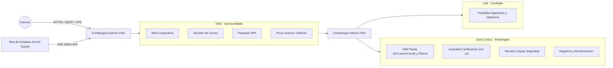

# UD04 · Práctica 1: Perímetro y zonas — Torrent S.L.

**Alumno:** Daniel Piqueras Burriel

---

## 1. Ubicación de servicios por zonas

Además de las cuatro zonas base (**Internet**, **DMZ**, **LAN** y **Zona crítica**), se ha creado una quinta zona denominada **Red de Invitados (Guest)**:

* **Defensa de la nueva zona (`Red de Invitados`):** Los dispositivos de visitas o proveedores externos no son de confianza como para entrar en la **LAN** corporativa, pero tampoco ofrecen servicios públicos hacia fuera como los servidores de la **DMZ**; aislarlos en una VLAN propia con salida directa a Internet evita cualquier movimiento lateral hacia los equipos internos.

| Servicio | Zona | Justificación |
| :--- | :--- | :--- |
| **1. Web corporativa pública** | **DMZ** | Debe ser accesible desde cualquier lugar de Internet por HTTPS, pero aislada de la LAN para que una intrusión en la web no comprometa la red interna. |
| **2. Servidor de correo** | **DMZ** | Necesita intercambiar correo (SMTP) directamente con servidores externos en Internet manteniendo el almacenamiento y la red corporativa protegidos detrás del cortafuegos interior. |
| **3. Pasarela VPN** | **DMZ** | Actúa como punto de entrada cifrado (mediante certificados de `srv-ca`) para que los técnicos remotos desde Internet accedan de forma controlada hacia la LAN o la Zona crítica. |
| **4. Proxy (saliente e inverso)** | **DMZ** | Como proxy inverso filtra las peticiones entrantes desde Internet hacia servicios web, y como proxy saliente intermedia la navegación de la LAN sin exponer directamente las IP internas. |
| **5. HMI de planta y carpeta de planos** | **Zona crítica** | Contiene el control industrial (`hmi.torrent.local`) y la propiedad intelectual de Torrent S.L., por lo que nunca debe ver Internet y solo admite conexiones muy restringidas. |
| **6. Autoridad de certificación (`srv-ca`)** | **Zona crítica** | Custodia la clave raíz (`ca.key`) que avala toda la confianza interna y de la VPN; si se compromete, un atacante podría suplantar cualquier servidor o usuario de la empresa. |
| **7. Servidor de copias de seguridad** | **Zona crítica** | Almacena los respaldos íntegros de toda la organización y es el objetivo principal del *ransomware*, por lo que requiere aislamiento estricto y acceso únicamente desde sistemas autorizados. |
| **8. Portátiles de ingenieros y operarios** | **LAN** | Son equipos corporativos gestionados y confiables desde los que el personal trabaja diariamente y accede mediante autenticación a los recursos autorizados. |
| **9. Wi-Fi de invitados** | **Red de Invitados** | Da conectividad a dispositivos externos no controlados que solo necesitan navegar por Internet sin tener visibilidad alguna sobre la LAN, la DMZ ni la Zona crítica. |
| **10. Servidor de registros y monitorización** | **Zona crítica** | Centraliza las auditorías y alertas de seguridad de toda la red, por lo que debe estar protegido para impedir que un atacante borre sus huellas tras comprometer otra zona. |

---

## 2. Tabla de flujos entre zonas

| Origen → Destino | ¿Permitido? | Ejemplo concreto |
| :--- | :--- | :--- |
| **Internet → DMZ** | **Sí (selectivo)** | Peticiones HTTPS (`443/TCP`) a la web corporativa, correo entrante SMTP (`25/TCP`) o inicio de túnel VPN (`1194/UDP` o `443/TCP`). |
| **Internet → LAN** | **No** | Cualquier conexión entrante directa desde Internet hacia los portátiles internos queda bloqueada por defecto en ambos cortafuegos. |
| **DMZ → LAN** | **No** | Un servidor comprometido en la DMZ (como la web o el correo) tiene prohibido iniciar conexiones hacia los equipos de la LAN; solo el tráfico autenticado de la pasarela VPN hacia recursos concretos se filtra estrictamente. |
| **LAN → DMZ** | **Sí (selectivo)** | Consulta del correo interno (IMAPS `993/TCP`), administración por SSH desde equipos autorizados o peticiones web a través del proxy (`3128/TCP`). |
| **LAN → Internet** | **Sí (a través de proxy)** | Navegación web (HTTP/HTTPS) de los ingenieros y operarios filtrada obligatoriamente a través del proxy saliente de la DMZ. |
| **LAN / VPN → Zona crítica** | **Sí (muy restringido)** | Acceso HTTPS (`443/TCP`) al panel `hmi.torrent.local` o SMB/SFTP a planos únicamente desde los portátiles de ingenieros autorizados con certificado válido. |
| **DMZ / LAN → Zona crítica (Logs)** | **Sí (unidireccional)** | Envío de eventos Syslog (`514/TCP` TLS) desde los servidores de la DMZ y la LAN hacia el servidor de registros y monitorización. |
| **Zona crítica → Internet** | **No** | El HMI, los planos, los backups y la CA (`srv-ca`) tienen bloqueada cualquier salida directa a Internet para evitar exfiltración de datos o conexiones de control remoto maliciosas. |
| **Red de Invitados → Internet** | **Sí** | Tráfico DNS y navegación web (`80/443`) directo hacia Internet, con bloqueo total hacia DMZ, LAN y Zona crítica. |

---

## 3. Diagrama de la red

---

## 4. Reflexión

Si el servidor web cae comprometido, el atacante solo podrá alterar la página pública o leer los ficheros locales de esa máquina dentro de la DMZ, pero no podrá saltar hacia los portátiles de la LAN ni alcanzar el panel HMI (`hmi.torrent.local`), los planos, las copias de seguridad o la CA (`srv-ca`). Se lo impide el **cortafuegos interior (`FW2`)**, que bloquea por defecto todo tráfico iniciado desde la DMZ hacia la LAN y la Zona crítica, mientras que el servidor de monitorización en la Zona crítica conserva intactos los registros del ataque.
